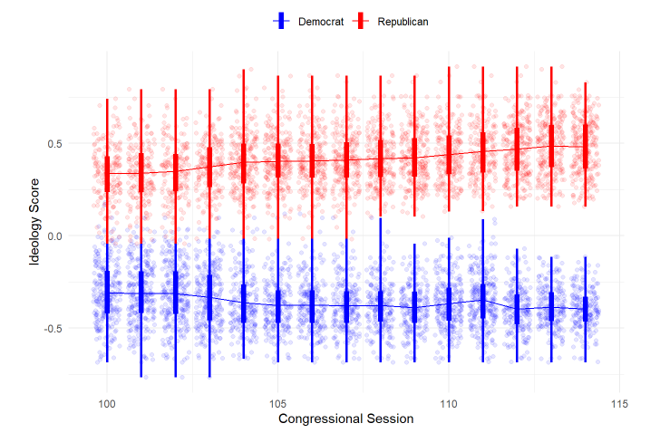

# Set Knitr Settings, Install and Load Packages

```{r setup, include = F} 
# set universal settings for all chunks
knitr::opts_chunk$set(warning = F, message = F,      # don't print warnings or messages. 
                      fig.width = 5, fig.height = 4) # format all figures as 5x4 inches.

# install two new packages you need:
#install.packages("GGally") # after you install, you can delete this line

# load the packages we will use in this lab
library(tidyverse) # basic package for data wrangling functions
# install.packages("GGally")
library(GGally)    # package for creating 2-way scatterplots with function 'ggpairs()'
# install.packages("ggridges")
library(ggridges) # package for creating ridgeplots
# install.packages("datasauRus")
library(datasauRus)

# my preferred ggplot2 theme
smTheme = function(){
  theme_bw() +
  theme(
    axis.ticks=element_blank(),
    panel.border=element_blank()
  )  
}
```


# Load data

We're going to use the same data set that showed up in the extra questions for the last problem set:

* `year`: year of observation
* `country`: country or country group name
* `country_code`: 3-letter ISO code
* `elec_access`: percent of the population with access to electricity
* `life_exp`: life expectancy in years
* `gdp_pc`: GDP per capita
* `pop_tot`: total population
* `pop_rural`: total rural population 
* `surgeon_per_100k`: number of surgeons per 100,000 people

```{r, results= "hide"}

# Load our dataset as wdi_raw
wdi_raw <- read_csv("wdiOrig.csv")
```

# Cleanup

Let's clean our data, creating a new dataset called `wdi`, following the same prescription in that problem set.

* Select all variables but `country_code`
* Filter observations to exclude small countries (population < 2 million)
* Create a variable `pop_rural_pct` for percent of population in living in rural areas
* Create a variable `gdp_pc_log` that is the log of GDP per capita
* Transform `elec_access` to be a decimal
* Round `life_exp` to the nearest whole number


```{r}
# Clean wdi_raw to create wdi
wdi <- wdi_raw %>%
  select(-country_code) %>%                   # select every variable except country code     
  filter(pop_tot >= 2000000) %>%              # include only observations with population over 2 mil
  mutate(pop_rural_pct = pop_rural/pop_tot,   # create new variable: percentage of population that is rural
         gdp_pc_log = log(gdp_pc),            # create new variable: logged gdp per capita
         elec_access = elec_access/100,       # mutate variable: pct. with electricity access (from 0-1) 
         life_exp = round(life_exp, 0))       # mutate variable: round life expectancy to the nearest whole number
```

# Dataset of Average Values (practice with `group_by()`, `summarize()` and NAs)

Currently, the unit of observation in this dataset is the country-year, as before lets just average by country so that the unit of observation is now just the country.


```{r, results = "hide"}
# Create data set with average values
wdi_avg <- wdi %>%
  group_by(country) %>%                                     # we are calculating an average for each country, so the grouping variable is country
  summarize(elec_access = mean(elec_access, na.rm = T),     # we need to include na.rm = T, otherwise it won't calculate a mean for countries missing values on this var!
            life_exp = round(mean(life_exp, na.rm = T), 0), # we want to round the mean to the nearest whole number 
            pop_rural_pct = mean(pop_rural_pct, na.rm = T), 
            gdp_pc_log = mean(gdp_pc_log, na.rm = T),
            surgeon_per_100k = mean(surgeon_per_100k, na.rm = T))

summary(wdi_avg) 

```

```{r}
# removing any rows that may have missing values and getting a quick summary 
omit_wdi_avg <- na.omit(wdi_avg)
summary(omit_wdi_avg)
```

## Dealing with missing values in `wdi_avg`

If a country has an NA on a variable after computing the average over 8 years, that means that country was missing data for every year in our dataset. 

We want to remove any country from the `wdi_avg` data set which has NAs on any variable. There are two ways to remove observations with NAs:

* `na.omit(dataframe_name)`: removes all observations that contain one or more NAs - will give you a data set with *no* missing values.
* `filter(!is.na(variable_name))`: removes all observations that have missing values for the specified variable, regardless of missingness on other variables.
* `drop_na(variable_name1, variable_name2)`: removes rows missing for specified variables

`drop_na` is likely the easiest option. 

```{r, results = "hide"}
# Remove Obs with Missing Values
wdi_avg = wdi_avg %>% drop_na(gdp_pc_log, surgeon_per_100k)

summary(wdi_avg) # now we have 103 obs, but no NAs!
```

# Univariate (one variable) statistics: life expectancy
($x$ denotes life expectancy)

## Mean

As we've discussed in the extra problem set solutions, the sample mean $\bar x$ is given by the sum of all x's $(\sum_{i=1}^n{x_i})$ divided by the total number of x's $(n)$:

$$\bar x = \frac{\sum_{i=1}^n{x_i}}{n}$$
## Variance

Sample variance $(\sigma^2)$ is equal to the sum of the distance of each observation from the mean $(x_i - \bar x)^2$ for all $n$ observations, divided by the total number of observations minus one $(n - 1)$:

$$\sigma^2 = \frac{\sum_{i=1}^n(x_i - \bar x)^2}{n-1}$$

```{r, results= 'hold'}
# By hand: Sum squared deviations from mean, divided by n-1
x = wdi_avg$life_exp
dist = x - mean(x)
distSq = dist^2
sumDistSq = sum(distSq)
varX = sumDistSq/(length(x) - 1)
varX

# do this one on your own for practice!

# R function
var(wdi_avg$life_exp)

```

## Standard deviation

Sample standard deviation $(\sigma)$ is equal to the square root of the sample variance $\sigma^2$:

$$ \sigma = \sqrt{\frac{\sum_{i=1}^n(x_i - \bar x)^2}{n-1}} = \sqrt{\sigma^2}$$

```{r, results= 'hold'}
# By hand: square root of the variance
sqrt(varX)

# R function
sd(wdi_avg$life_exp)

```

You can also think of the standard deviation as a representation of the average distance from the mean for each observation. 

## Review of univariate functions

Let's create a new data frame with all the summary statistics we just learned to create along with some that we've seen before (i.e., the quantile function).

```{r}
sum_wdi = wdi_avg %>%
  summarize(min = min(life_exp),
            mean = mean(life_exp),
            median = median(life_exp),
            max = max(life_exp),
            qt25 = quantile(life_exp, .25),
            qt75 = quantile(life_exp, .75),            
            var = var(life_exp),
            sd = sd(life_exp),
            n = length(life_exp))
```

## Visualizing univariate functions with uncertainty

Default way that we've used to visualize uncertainty in a continuous variable is via histograms and density plots. But these are not always the best option. Say that I wanted to visualize how life expectancy has changed over time across all countries (note that we'll need to go back to the `wdi` object for this information). Can we just use a bunch of histograms? Lets try. 

```{r}
ggplot(wdi, aes(x=life_exp)) + 
  geom_histogram() +
  facet_wrap(~year) +
  smTheme()
```

Not really easy to see any trends when we just have a bunch of histograms. There are some fun solutions to this problem. A common approach if one wants to stick to histograms is what we call a ridge plot, which are essentially sets of density distributions stacked on top of one another so that you can understand how distributions are shifting over time. We can implement this within `ggplot` using the `geom_density_ridges` function the `ggridges` package (yes, a number of people have developed additional packages meant to expand the functionality of `ggplot2`).

```{r}
ggplot(wdi, aes(x=life_exp, y=factor(year))) + 
  geom_density_ridges() +
  smTheme()
```

But what if we had fifty years of data ... would you really want to make a ridgeplot for a setting like that? (The answer is no.) 

Well, what we can do instead are to use numeric summaries of our data to create a visualization. You have all seen something like this before, the most common example is a box-plot. 

```{r}
ggplot(wdi, aes(x=factor(year), y=life_exp)) + 
  geom_boxplot() +
  smTheme()
```
The box border represents the interquartile range (i.e., 25th to 75th percentile), the dark horizontal line inside each box represents the median, and the lines portruding up and down from the box are referred to as the whiskers and are meant to provide some representation of the distribution of the data. 

One thing that we lose when we shift to plots that are essentially numerical summaries of our data, however, is the actual data and whether or not the summary statistics are reliable representations of that data. To deal with this we can overlay the actual data onto the plot using a function called `geom_jitter`. When using geom_jitter we typically will also want to toggle the transparency of the points so that they dont just cover up the boxpots we drew and we can do this using the `alpha` parameter.  

```{r}
#jitter with width and height

ggplot(wdi, aes(x=factor(year), y=life_exp)) + 
  geom_boxplot() +
  # geom_point() 
  geom_jitter(alpha=0.2, width=.1) + # jitter is used to overlay the data into ggplot, alpha sets the transparency level
  smTheme()
```
Related, to box pots we also have things like violin plots, which try to essentially use a density estimation approach to highlight the shape of the data.

```{r}
ggplot(wdi, aes(x=factor(year), y=life_exp)) + 
  geom_violin() +
  geom_jitter(alpha=.1) +
  smTheme()
```

##### lab4

Last, you can always construct your own as well. First step is to calculate the summary statistics and then just visualize. 

First lets calculate some summary stats and add them back to `wdi`.

```{r}
wdi = wdi %>%
  group_by(year) %>%
  mutate(
    life_exp_year_mean = mean(life_exp),
    life_exp_year_median = median(life_exp),
    life_exp_year_qt25 = quantile(life_exp, .25),
    life_exp_year_qt75 = quantile(life_exp, .75),    
  )
```

Next lets expore visualization options, one is to just use `geom_linerange`.

```{r}
ggplot(wdi, aes(x=factor(year))) +
  geom_point(aes(y=life_exp_year_mean), size=2) +
  geom_linerange(aes(ymin=life_exp_year_qt25, ymax=life_exp_year_qt75)) +
  geom_jitter(aes(y=life_exp), alpha=.1) +
  smTheme()
```

Looks kinda dumb in this case, you're probably like why use this when the boxplot looks so much nicer. Well, learning to do this stuff on your own can help you make some pretty things down the road. Lets wrap a "ribbon" around this section before we move onto bivariate stuff.

```{r}
ggplot(wdi, aes(x=year)) +
  geom_line(aes(y=life_exp_year_mean), color = 'blue') +  
  geom_point(aes(y=life_exp_year_mean), size=2, color = 'red') +
  geom_ribbon(aes(ymin=life_exp_year_qt25, ymax=life_exp_year_qt75), alpha=.5, fill = 'salmon') +
  geom_jitter(aes(y=life_exp), alpha=.1) +
  smTheme()
```

Here's a somewhat prettier example:

```{r, echo=FALSE}

```


# Bivariate statistics: life expectancy and electricity

($x$ denotes life expectancy, $y$ denotes electricity access)

```{r}
# Set values to be used in equations below 

# Set x = life expectancy, y = electricity access
x = wdi_avg$life_exp
y = wdi_avg$elec_access

# Set n, x_bar = avg life exp, y_bar = avg elec access
n = nrow(wdi_avg)
x_bar = mean(wdi_avg$life_exp)
y_bar = mean(wdi_avg$elec_access)
```

## Covariance
Sample covariance $Cov(X,Y)$ is given by the deviations from mean of x $(x_i - \bar x)$ multiplied by the deviations from mean of y $(y_i -\bar y)$, summed over $n$ observations, divided by $n-1$.

Covariance is important for a few reasons: 
**direction of re**: positive cov = vars increase/decrease together. neg cov = as one var increases, the other decreases 
**multivariate stats & modeling**: helps us summarize the the rel bw several vars. In order to do regression analysis, covariance helps us understand multicollinearity. IVs = predictors, DVs = outcomes. 

Covariance is really important for us bc it helps us understand the relationships bwt vars!!!!!

$$Cov(X,Y) = \frac{ \sum_{i=1}^n(x_i -\bar x)  (y_i -\bar y)}{n-1} $$

```{r, results = "hold"}
# By hand (recall values set above): 
sum((x - x_bar)*(y - y_bar))/(n-1)

# R function
cov(x, y)
```

## Correlation
Sample correlation coefficient is the covariance of X and Y $(Cov(X,Y))$ divided by the standard deviation of X multiplied by the standard deviation of Y $(\sigma_x * \sigma_y)$:
$$Cor(X,Y) = \frac{ Cov(X,Y) }{ \sigma_x \sigma_y } $$
Correlation is important for a few reasons: 
**strength of relationship**: covariance just tells us pos or neg, but correlation will tell us how strong that relationship is. BUT, correlation does not tell us the strength of non-linear relationship. Correlation is linear specific in a way. 
  - 1 = perf pos 
  - 0 = no linear rel 
  - -1 = perf neg 
**standardization**: correlation, unlike covar, does not depend on the units of the vars. This is helpful for when you have many vars that have diff units, or in cases where you may be looking at several diff datasets. 
**hypoth testing**: correlation coefficients are often tested to see if the relationship between two vars is real or just due to random chance (we will get into this a bit deeper). 

Overall, correlation is important because it provides a clear, standardized way to assess the strength and direction of a relationship between variables. It’s easy to interpret, versatile across various fields, and central to understanding relationships in data analysis and predictive modeling.


```{r, results="hold"}
# By hand: Covariance divided by sd(X)*sd(Y)
cov(x, y)/(sd(x)*sd(y))

# R function
cor(x,y)
```


# Visualizing Correlation through Bivariate Plots

## Beware correlation coefficients

Correlation coefficients are really nice. They seem super interpretable and give you a quick understanding of the linear relationship between two variables. But! Never rely on them for anything important without also taking the time to plot your data. 

Here's a fun example as to why using some data from the `datasauRus` package. First just a peak at the dataset:

```{r}
head(datasaurus_dozen)
```
And now lets calculate some summary statistics of `x` and `y` and correlation coefficients between those two variables by `dataset`. 

```{r}
datasaurus_dozen %>% 
  group_by(dataset) %>% 
  summarize(
    mean_x    = mean(x),
    mean_y    = mean(y),
    std_dev_x = sd(x),
    std_dev_y = sd(y),
    corr_x_y  = cor(x, y)
  )
```

Woah, the summary stats of `x` and `y` by `dataset` are all pretty much the same. How could this be! Maybe this `dataset` variable doesn't matter and there is just some general "truth" across each of these datasets. Well, lets double check by at least plotting the data. 

```{r}
ggplot(datasaurus_dozen, aes(x = x, y = y, colour = dataset))+
  geom_point() +
  smTheme() +
  theme(legend.position = "none")+
  facet_wrap(~dataset, ncol = 3)
```
Woopsie daisie, these datasets are telling us very different stories! Always plot your data. 

## Look at correlation between all variables (pairwise scatterplots)

A quick way to look at bivariate scatters in your dataset is the `ggpairs()` function from the `GGally` package. This will give us:

* In the bottom left: Pairwise scatterplots for all variables in the dataset. 
* On the diagonal: the probability density function (pdf) for each variable.
* In the top right: the correlation between each pair of variables. 

Looking at the `ggpairs()` output:

* Which two variables in the `wdi_avg` data set are most strongly correlated? What's the nature of these two variables' relationship to one another?

```{r}
# pairwise plots - WDI average
ggpairs(wdi_avg %>% select(-country)) # we select all variables but country (not numeric)
```

```{r}
ggplot(wdi, aes(x=surgeon_per_100k, y=gdp_pc_log)) +
  geom_point()

ggplot(wdi, aes(x=surgeon_per_100k, y=gdp_pc_log)) +
  geom_density2d_filled()

```
